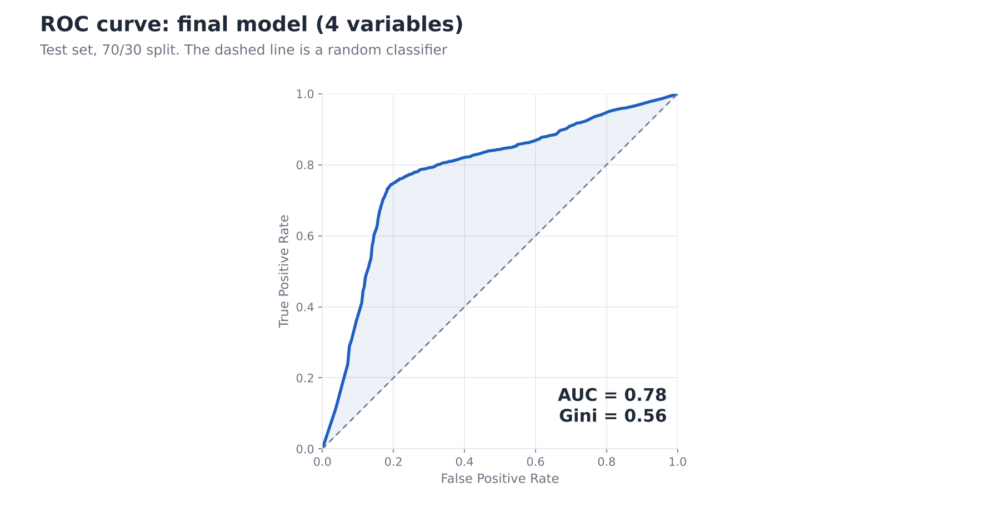

# Credit Score Classification: Logistic Regression with WoE

A credit risk model that estimates the probability that a customer has a **Poor** credit score, built with logistic regression on Weight of Evidence (WoE) transformed variables. The project follows a classic scorecard-style workflow, from data preparation to deployment on new customers.

## Problem

- **Target:** `score` = 1 if `CreditScore` is *Poor*, 0 if *Standard* or *Good*
- **Data:** 87,495 observations, 26 raw columns (29% of observations are Poor)
- **Output:** probability of default (PD) for each customer

## Methodology

1. **Data preparation:** identifier columns (`ID`, `CustomerID`, `Name`, `SSN`) and the high-cardinality `TypeofLoan` are removed; `CreditScore` is converted to the binary target.
2. **Missing values:** imputed with the mode (categoric) and the mean (numeric).
3. **WoE transformation:** numeric variables are split into quartile bins, categoric variables keep their own categories; `WoE = ln(share of target 0 / share of target 1)`.
4. **Distribution check:** Kolmogorov-Smirnov test shows the variables are not normally distributed, so Spearman correlation is used.
5. **Feature selection:**
   - correlation with the target (|ρ| > 0.1) keeps 14 variables;
   - intercorrelation (threshold 0.7) flags one pair, `AnnualIncome` and `MonthlyInhandSalary`;
   - univariate Gini analysis keeps the four strongest variables (Test Gini > 0.40).
6. **Modelling:** logistic regression, 70/30 train-test split (`random_state=42`).
7. **Evaluation:** Gini, Precision, Recall, confusion matrix and ROC curve.
8. **Deployment:** raw values of new customers are mapped to WoE using the bin boundaries of the training data, then PD is predicted.

## Results

| Model | Variables | Train Gini | Test Gini | Test Precision | Test Recall |
|---|---|---|---|---|---|
| Full WoE model | 14 | 59.4 | 58.7 | 0.628 | 0.558 |
| **Final model** | **4** | **56.6** | **55.9** | **0.627** | **0.581** |

Final variables: `OutstandingDebt`, `InterestRate`, `NumCreditInquiries`, `Delayfromduedate`.



The gap between train and test Gini is below 1 point, so the model is stable. Reducing the model from 14 to 4 variables costs about 3 Gini points and makes it much easier to explain.

## Model coefficients

| Variable (WoE) | Coefficient |
|---|---|
| `OutstandingDebt_woe` | -0.498 |
| `InterestRate_woe` | -0.426 |
| `Delayfromduedate_woe` | -0.288 |
| `NumCreditInquiries_woe` | -0.271 |
| Intercept | -0.889 |

All coefficients are negative. This is expected: WoE is defined as `ln(good / bad)`, so a higher WoE means a lower probability of a Poor score. `OutstandingDebt` and `InterestRate` have the largest influence on PD.

## Limitations

- **Repeated customers.** The 87,495 rows belong to 12,500 customers (2 to 8 monthly rows each). With a random split, 99.9% of test rows belong to a customer who is also in the training set. As a check, the model was re-estimated with a split by customer and WoE bins fitted on the training part only: Test Gini was 57.6 (vs 55.9), so the reported Gini is not inflated by this. The check used a single split, so it is indicative rather than conclusive.
- **WoE on the full data.** In the main workflow WoE is calculated before the train-test split; a production model should fit the bins on the training data only.
- **Data quality.** 7,526 rows (8.6%) have an implausible `Age` (for example -500 or 8698) and several other variables contain extreme values. They were not cleaned: quartile binning places them in the first or last bin.
- **Missing values** were imputed with the mean or mode without a missing-value category, which can hide a pattern in the missingness.
- **Target definition.** Standard and Good are merged into one class; the model predicts the *Poor* class only.
- **Validation.** One random split (`random_state=42`); no out-of-time validation or calibration check was performed.

## Repository structure

```
.
├── Logistic_Regression_Credit_Score.ipynb   # full analysis
├── img3_roc_curve.png
├── requirements.txt
└── README.md
```

The input files (`credit_score.csv`, `test_data_real_values.xlsx`) are not included. Place them in the same folder as the notebook before running it.

## How to run

```bash
pip install -r requirements.txt
jupyter notebook
```

Open the notebook and choose **Kernel → Restart & Run All**.

## Tech stack

Python, pandas, NumPy, scikit-learn, SciPy, Matplotlib, Seaborn
